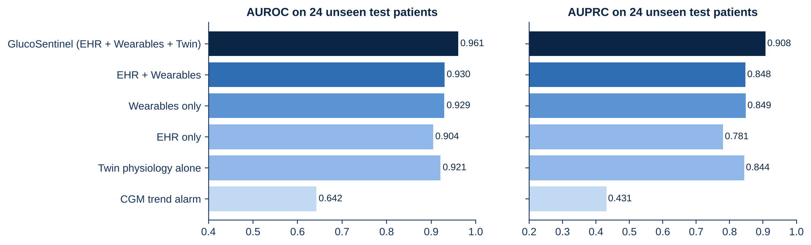
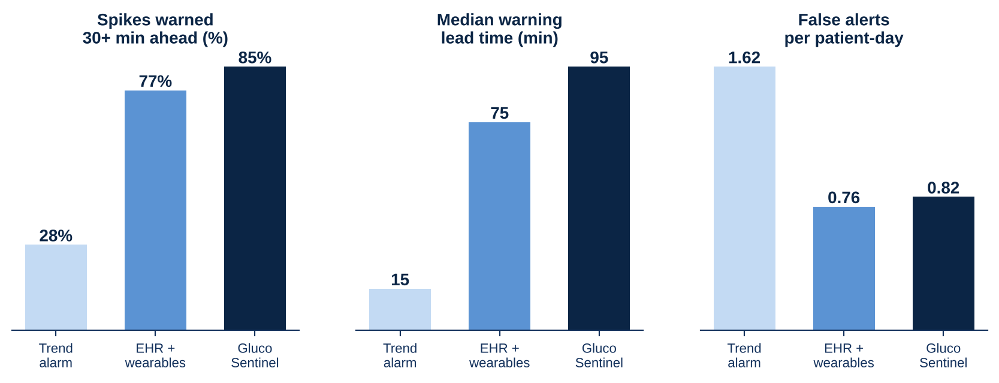
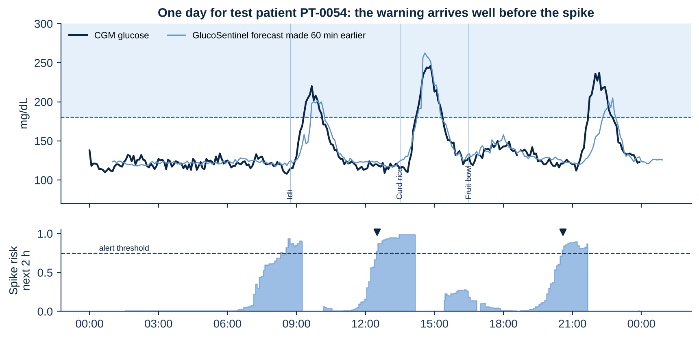
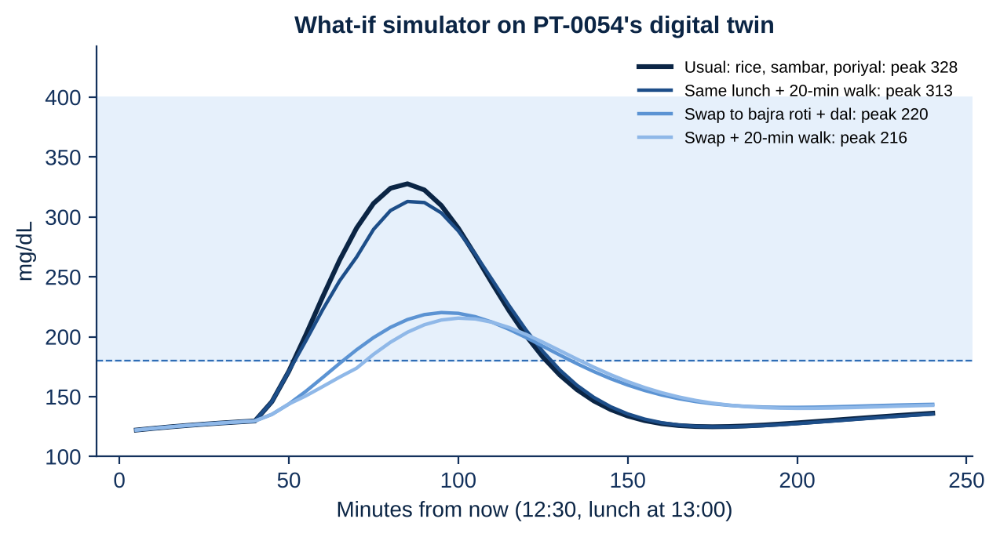
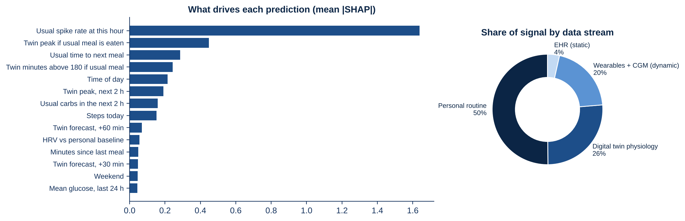
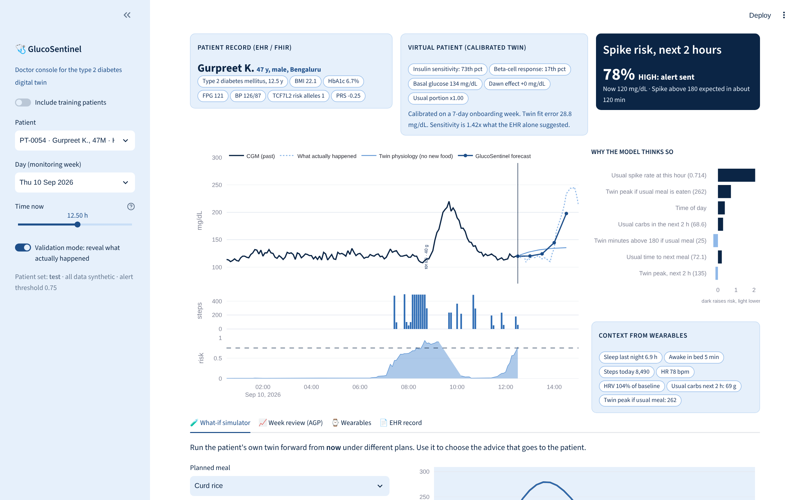

# GlucoSentinel: a digital twin that warns of glucose spikes 2 hours before they happen

**Happiest Health Digital Twin Challenge 2026: Phase 1, Prototype and Code Submission**

GlucoSentinel (a sentinel is a guard who warns before danger arrives) is a proof-of-concept digital twin for **type 2 diabetes**. It fuses a patient's **static health record** (HL7 FHIR R4 EHR with labs, diagnoses, medications and genetic markers) with **dynamic wearable data** (5-minute CGM, heart rate, HRV, sleep stages, steps and a meal log). From these two streams it builds a calibrated virtual copy of each patient's glucose physiology. It then predicts whether a glucose spike above 180 mg/dL will begin within the next **2 hours**, explains why, and lets a doctor simulate "what if" changes on that patient before giving advice.

| Headline result (24 unseen test patients, 582 spike episodes) | GlucoSentinel | CGM trend alarm (today) |
|---|---|---|
| AUROC, spike in next 2 h | **0.961** | 0.642 |
| Spikes warned at least 30 min ahead | **84.7%** | 27.5% |
| Median warning lead time | **95 min** | 15 min |
| False alerts per patient per day | **0.82** | 1.62 |
| 60-min glucose forecast in Clarke zone A | **93.5%** | n/a |

All data is synthetic; no real patient data is used anywhere (see [Data and the sandbox rules](#data-and-the-sandbox-rules)).

---

## Contents

1. [Team details](#1-team-details)
2. [College / incubator information](#2-college--incubator-information)
3. [Project title](#3-project-title)
4. [Problem statement](#4-problem-statement)
5. [Healthcare use case](#5-healthcare-use-case)
6. [Technical stack](#6-technical-stack)
7. [AI/ML model and framework details](#7-aiml-model-and-framework-details)
8. [Demo video](#8-demo-video)
9. [Open-source licence](#9-open-source-licence)
10. [Architecture diagram](#10-architecture-diagram)
11. [Presentation](#11-presentation)
12. [Public access to all files](#12-public-access-to-all-files)
13. [Results](#13-results)
14. [Quick start](#14-quick-start)
15. [Repository structure](#15-repository-structure)
16. [Limitations and next steps](#16-limitations-and-next-steps)

---

## 1. Team details

| Field | Detail |
|---|---|
| Team name | **Dinesh** |
| Team leader | **Dinesh D S** |
| Team size | 1 |
| Programme | Post Graduate Programme in Food and Agri-Business Management (PGP-FABM), 2025-27 |
| Role in project | Problem framing, data simulation, digital twin, ML model, dashboard, documentation |

## 2. College / incubator information

| Field | Detail |
|---|---|
| Institute | **Indian Institute of Management Ahmedabad (IIMA)** |
| Location | Vastrapur, Ahmedabad, Gujarat, India |
| Programme | PGP-FABM 2025-27 |
| Submission folder | `Dinesh_IIMAhmedabad` (Team Name_College Name) |

## 3. Project title

**GlucoSentinel: a personal digital twin that predicts glucose spikes in type 2 diabetes 2 hours in advance, by fusing FHIR health records with wearable data**

## 4. Problem statement

India has about **101 million** adults with diabetes and **136 million** with prediabetes (ICMR-INDIAB national survey of 113,043 adults across 31 states and union territories, *Lancet Diabetes and Endocrinology*, 2023). Much of the day-to-day damage happens **after meals**, when glucose spikes above 180 mg/dL. Three gaps keep these spikes unmanaged:

* **HbA1c hides spikes.** It is a 3-month average. In our cohort, two patients with HbA1c 6.9% and 7.0% spend 11% and 24% of their day above 180 mg/dL.
* **Today's tools react, they do not anticipate.** A CGM trend alarm only sees a rise once it has begun. On our test patients it warned just 27.5% of spikes at least 30 minutes ahead, with a median lead of 15 minutes.
* **Data sits in silos and in volume.** The EHR lives with the hospital and wearable data on the phone. A single patient produces 4,032 CGM readings per fortnight plus heart rate, HRV, sleep and steps, far more than a doctor can read.

**Challenge question addressed:** can a digital twin that fuses static EHR data with dynamic wearable data predict an adverse event, a post-meal glucose spike, early enough to act on, and show a doctor how to prevent it for *this* patient?

## 5. Healthcare use case

**Condition:** type 2 diabetes and prediabetes, the most prevalent chronic lifestyle condition in India.
**Adverse event predicted:** onset of a CGM glucose excursion above 180 mg/dL lasting at least 15 minutes, within the next 120 minutes.

**Clinical workflow**

1. **Onboarding (week 1).** The patient wears a CGM and smartwatch for 7 days and logs meals. The twin starts from the EHR (FHIR) and calibrates itself to the patient's own glucose response.
2. **Monitoring.** Every 5 minutes the twin assimilates the new CGM reading and the model scores the 2-hour spike risk.
3. **Alert.** When risk crosses the threshold (tuned for about one false alert per patient-day), the doctor console flags the patient and shows why.
4. **What-if.** The doctor runs the twin forward on alternatives (swap rice for bajra roti, smaller portion, 20-minute walk, a better night's sleep, a medication change) and picks the plan that lowers the predicted peak.
5. **Nudge.** The doctor sends a plain-language nudge to the patient before the meal.
6. **Review.** Before the next visit the doctor sees the weekly ambulatory glucose profile (AGP), time in range and alerts.

**Who benefits:** patients (advice before the meal), doctors (one screen instead of thousands of readings, triage), insurers and employers (measurable time-in-range outcomes), and the public health system (FHIR R4 in and out, ready for ABDM).

## 6. Technical stack

| Layer | Tools |
|---|---|
| Language | Python 3.10+ |
| Data and simulation | NumPy, pandas, PyArrow (Parquet) |
| Health data standard | HL7 FHIR R4 bundles with ICD-10, LOINC and RxNorm codes (Synthea-style) |
| Physiology / digital twin | Custom vectorised glucose-insulin model (extended Bergman minimal model) in NumPy |
| Machine learning | LightGBM (classifier and quantile-robust L1 regressors), scikit-learn metrics |
| Explainability | LightGBM TreeSHAP contributions (`pred_contrib`) |
| Doctor dashboard | Streamlit + Plotly |
| Figures | Matplotlib |
| Testing | pytest |
| Hardware needed | Any laptop CPU; the full pipeline runs in about 8 minutes on 2 cores, no GPU |

## 7. AI/ML model and framework details

GlucoSentinel is a **hybrid**: a mechanistic physiology twin per patient plus a gradient-boosted model on top.

### 7.1 The digital twin (physics-informed)

Each patient twin is an extended **Bergman minimal model**, stepped every 5 minutes:

```
dG/dt = -(SG + X) G + SG Gb(t) + Ra(t)/V - ex * cadence * (G - 60)     glucose
dX/dt = -p2 X + p2 SI s(t) (I - Ib)                                      insulin action
dI/dt = -n (I - Ib) + gamma * max(G - Gb(t), 0)                          insulin secretion
Ra(t): two gut pools (fast and slow carbohydrate), split by each meal's glycaemic index
Gb(t): basal glucose with a dawn-phenomenon bump; s(t): insulin-sensitivity multiplier lowered by sleep debt
```

The twin is built in four steps (`src/glucosentinel/twin.py`):

| Step | What happens |
|---|---|
| **A. EHR prior** | The FHIR bundle (HbA1c, fasting glucose, BMI, years since diagnosis, TCF7L2 genotype, PRS, medications) sets starting values for insulin sensitivity `SI`, beta-cell response `gamma`, basal glucose `Gb` and dawn effect. |
| **B. Calibration** | Over the 7-day onboarding week, 625 candidate physiologies are simulated in one vectorised pass, then a 256-point zoom around the best. Each is scored on how well it forecasts the patient's own CGM at 30, 60 and 120 minutes, with a penalty for straying far from the EHR prior. About 5.5 CPU-seconds per patient. |
| **C. Assimilation** | Every 5 minutes the twin's glucose state is nudged 60% of the way toward the new CGM reading, like a weather model assimilating observations. |
| **D. Simulation** | From any moment, the twin runs forward 2 to 4 hours under scenarios (meal, portion, walk, sleep, medication). This powers the twin features and the what-if lab. |

Calibrated insulin sensitivity correlates **r = 0.92** (log scale) with the simulator's hidden true value across 120 patients.

### 7.2 The spike predictor (machine learning)

* **Features (81, every 5 minutes)**
  * **E, EHR (23):** age, sex, BMI, waist, diabetes duration, hypertension, dyslipidaemia, family history, TCF7L2 risk alleles, PRS, metformin, sulfonylurea, DPP-4 inhibitor, BP, lipids, eGFR, HbA1c and 12-month trend, fasting glucose, resting HR, prediabetes flag.
  * **W, wearables (40):** CGM level, deltas, slope, acceleration, rolling mean, SD, min, max, time above 180; logged carbs and glycaemic load; steps and time since last walk; heart rate and HR above rest; HRV relative to personal baseline; last night's sleep hours, awakenings and deep-sleep share; time of day; weekend.
  * **R, personal routine (5):** usual spike rate, usual carbs and usual time to the next meal at this time of day, learned only from week 1.
  * **T, twin (13):** twin forecasts at +30, +60 and +120 min, twin peak in the next 2 h, twin peak and minutes above 180 if the usual meal is eaten, carbs still being absorbed, active insulin action, and the calibrated parameters.
* **Classifier:** LightGBM, binary objective, 31 leaves, learning rate 0.04, feature and bagging fraction 0.8, early stopping on validation patients.
* **Forecasters:** four LightGBM regressors (L1 loss) predict glucose at +30, +60, +90 and +120 minutes for the dashboard curve.
* **Alert policy:** threshold **0.75**, chosen on validation patients only, to warn of as many spikes as possible while keeping false alerts at or below about one per patient-day; at most one alert per hour; prediction pauses while glucose is already above 180.
* **Explainability:** per-alert TreeSHAP contributions, shown to the doctor with plain-English feature names.

### 7.3 Evaluation protocol

* **Patient-level split:** 84 train, 12 validation, 24 test patients (no person in two sets).
* **Time split:** week 1 is only used to calibrate the twin and learn routine; all models are trained and scored on week 2.
* **Metrics:** AUROC, AUPRC, episode-level warning rate and lead time, false alerts per day, forecast RMSE and MAE, Clarke error grid, subgroup AUROC.

## 8. Demo video

**Demo video (unlisted YouTube, about 20 minutes): https://youtu.be/ADD_YOUR_VIDEO_ID**

The video walks through the presentation and then demonstrates the live doctor console. The full narration script with timings is in [`docs/Demo_Video_Script.md`](docs/Demo_Video_Script.md), and every slide carries speaker notes.

## 9. Open-source licence

This project is released under the **MIT Licence**. See [`LICENSE`](LICENSE). All data in this repository is synthetic and may be reused freely.

## 10. Architecture diagram

* PDF: [`docs/Architecture_Diagram.pdf`](docs/Architecture_Diagram.pdf)
* Editable PowerPoint: [`docs/Architecture_Diagram.pptx`](docs/Architecture_Diagram.pptx)

```
 EHR (FHIR R4) --+                                                        +--> Doctor console
                 +--> Ingest --> Digital twin engine --> Fusion + LightGBM --+    (risk, forecast, why, what-if, AGP)
 Wearables ------+    5-min      A prior, B calibrate    81 features         +--> Patient nudge
 CGM, HR, HRV,        grid, QC   C assimilate            spike risk, 4 forecasts,
 sleep, steps, meals             D simulate              SHAP, alert policy
```

## 11. Presentation

* PDF: [`docs/GlucoSentinel_Presentation.pdf`](docs/GlucoSentinel_Presentation.pdf)
* PowerPoint with speaker notes: [`docs/GlucoSentinel_Presentation.pptx`](docs/GlucoSentinel_Presentation.pptx)

The deck covers the executive summary, problem, solution, data, twin engine, AI model, results, dashboard, impact, roadmap and cost, plus an annexure with full metrics.

## 12. Public access to all files

Everything needed to evaluate the project is inside this public repository: code, synthetic data, trained models, calibrated twins, metrics, figures, architecture diagram, presentation and video script. No file needs a login or special permission. The demo video is an unlisted YouTube link, which anyone with the link can watch.

---

## 13. Results

All numbers are on **24 test patients the model never saw**, scored on week 2 (35,601 five-minute rows, 30% positive, 582 spike episodes). Every number below is read from [`reports/metrics.json`](reports/metrics.json).

### Ablation: each data stream and the twin add signal

| Approach | AUROC | AUPRC |
|---|---|---|
| CGM trend alarm (30-min projection) | 0.642 | 0.431 |
| EHR + time of day | 0.904 | 0.781 |
| Twin physiology alone (no ML) | 0.921 | 0.844 |
| Wearables only | 0.930 | 0.849 |
| EHR + wearables (fusion) | 0.930 | 0.848 |
| **GlucoSentinel: EHR + wearables + twin** | **0.961** | **0.908** |



### Clinical view: earlier warnings, fewer false alarms

| Episode metric | CGM trend alarm | EHR + wearables | **GlucoSentinel** |
|---|---|---|---|
| Spikes warned at least 30 min ahead | 27.5% | 77.1% | **84.7%** |
| Spikes warned at all | 83.7% | 88.0% | **91.8%** |
| Median lead time | 15 min | 75 min | **95 min** |
| Alert precision | 65.2% | 78.6% | **79.1%** |
| False alerts per patient-day | 1.62 | 0.76 | **0.82** |



### Glucose forecasts

| Horizon | Persistence RMSE | Twin alone RMSE | **GlucoSentinel RMSE** | GlucoSentinel MAE |
|---|---|---|---|---|
| +30 min | 27.0 | 22.3 | **12.0** | 7.9 |
| +60 min | 43.1 | 27.1 | **19.2** | 11.5 |
| +90 min | 50.6 | n/a | **22.1** | 13.4 |
| +120 min | 52.6 | 35.4 | **23.3** | 14.5 |

Clarke error grid for the 60-minute forecast: **93.5% zone A, 99.6% zones A + B**, 0% in zones C and E.

### One test patient, one day



Patient PT-0054 (synthetic, 47, type 2 diabetes for 12.5 years, HbA1c 6.7%) received three alerts: 08:20 (breakfast spike began 09:20), 12:30 (lunch spike began 14:15) and 20:35 (dinner spike began 21:45, even though dinner was not logged).

### What-if simulation on the same patient's twin



Swapping the usual rice, sambar and poriyal lunch for bajra roti and dal lowers the twin's predicted peak from **328 to 220 mg/dL**; a 20-minute walk alone lowers it to 313.

### Explainability and fairness



| Subgroup (test) | Patients | AUROC |
|---|---|---|
| Women | 8 | 0.967 |
| Men | 16 | 0.957 |
| South India | 12 | 0.961 |
| West India | 8 | 0.957 |
| North India | 2 | 0.974 |
| East India | 2 | 0.955 |
| Prediabetes | 3 | 0.965 |
| Type 2 diabetes | 21 | 0.958 |

### Doctor dashboard



---

## 14. Quick start

```bash
git clone https://github.com/missionppo2027-collab/Dinesh_IIMAhmedabad.git
cd Dinesh_IIMAhmedabad
pip install -r requirements.txt

# open the doctor console on the data already in the repo
streamlit run dashboard/app.py

# rebuild everything from scratch (about 8 minutes on 2 CPU cores)
python run_all.py

# unit tests
pytest -q
```

Step by step, if you prefer: `python -m glucosentinel.generate`, `python -m glucosentinel.build_features`, `python -m glucosentinel.train`, `python -m glucosentinel.figures` (run with `PYTHONPATH=src`).

## Data and the sandbox rules

The challenge requires anonymised, open-source or synthetic data. GlucoSentinel uses **only synthetic data**, generated by `src/glucosentinel/` with fixed seeds:

* **Cohort:** 120 synthetic Indian adults (107 type 2 diabetes, 13 prediabetes; south 51, west 30, north 24, east 15), each with hidden physiology causally linked to their EHR attributes.
* **Static stream:** `data/ehr/patients.csv` and one **FHIR R4 bundle per patient** in `data/ehr/fhir/` (Patient, Condition with ICD-10, Observation with LOINC including three HbA1c values, MedicationStatement with RxNorm, FamilyMemberHistory, genetic Observation with TCF7L2 rs7903146 and a PRS). The twin reads the EHR **from the FHIR bundle**, not from the CSV.
* **Dynamic stream:** `data/wearables/cgm_wearables_5min.parquet` (14 days x 288 readings per patient: CGM, steps, heart rate, HRV RMSSD, sleep stage), mimicking Libre / Apple Health / Google Fit exports, and `data/wearables/meal_log.csv` (5,200 logged meals from a 32-dish Indian meal library).
* **Realism built in:** 8-minute blood-to-sensor lag, autocorrelated CGM noise, 2% dropouts and signal gaps, about 20% of meals not logged, carb estimates off by about 22%, poor-sleep nights, stress days, festival sweets, weekend shifts.
* **Ground truth** (`data/ground_truth/`) holds the true blood glucose, true meals and hidden parameters. It is used **only** to validate the twin's parameter recovery, never as a model input.

## 15. Repository structure

```
Dinesh_IIMAhmedabad/
|-- README.md                 this file (all 12 required items)
|-- LICENSE                   MIT
|-- requirements.txt
|-- run_all.py                one command: data, twins, models, metrics, figures
|-- src/glucosentinel/
|   |-- cohort.py             synthetic Indian cohort: EHR fields, hidden physiology, lifestyle
|   |-- simulate.py           1-minute physiology simulation, wearable and CGM sensor models
|   |-- fhir.py               FHIR R4 bundle writer and reader
|   |-- foods.py              Indian meal library (carbs, GI) and low-GI swaps
|   |-- physiology.py         vectorised glucose-insulin model shared by simulator and twin
|   |-- twin.py               PatientTwin: EHR prior, calibration, assimilation, what-if
|   |-- features.py           81 fused features and spike labels
|   |-- train.py              LightGBM models, ablation, episode metrics, Clarke grid, SHAP, fairness
|   |-- figures.py            report figures
|   |-- explain.py            doctor-friendly feature names
|   `-- generate.py, build_features.py, store.py
|-- dashboard/app.py          Streamlit doctor console
|-- data/                     ehr (CSV + FHIR), wearables, ground_truth, processed (per patient)
|-- models/                   spike_model.txt, forecast_*.txt, feature_list.json, twins/*.json
|-- reports/                  metrics.json, figures
|-- docs/                     Architecture_Diagram (PDF, PPTX), GlucoSentinel_Presentation (PDF, PPTX), Demo_Video_Script.md
`-- tests/test_core.py
```

## 16. Limitations and next steps

* **Synthetic data flatters accuracy.** The simulator and the twin share a model family, so real-world performance will be lower. The next step is a retrospective test on real, openly licensed CGM datasets, then an ethics-approved clinic pilot.
* **Routine features** need a stable first week; shift workers and travel will be harder.
* **No hypoglycaemia module yet**, which matters for sulfonylurea users.
* **Medication what-ifs are illustrative**, not dose guidance.
* **Not a medical device.** GlucoSentinel is a research prototype; a doctor stays in the loop for every nudge.

**Roadmap (12 months):** retrospective validation on real CGM data, hypoglycaemia module, photo and voice meal logging in Indian languages, ethics approval and a 50-patient, 3-month clinic pilot, then ABDM / FHIR integration and the software-as-a-medical-device pathway.

## References

* Anjana RM et al. Metabolic non-communicable disease health report of India: the ICMR-INDIAB national cross-sectional study (ICMR-INDIAB-17). *Lancet Diabetes and Endocrinology*, 2023.
* Bergman RN et al. Quantitative estimation of insulin sensitivity. *American Journal of Physiology*, 1979 (minimal model).
* Hovorka R et al. Nonlinear model predictive control of glucose concentration in subjects with type 1 diabetes. *Physiological Measurement*, 2004 (gut absorption model).
* Clarke WL et al. Evaluating clinical accuracy of systems for self-monitoring of blood glucose. *Diabetes Care*, 1987.
* Battelino T et al. Clinical targets for continuous glucose monitoring data interpretation: recommendations from the International Consensus on Time in Range. *Diabetes Care*, 2019.
* Walonoski J et al. Synthea: an approach, method, and software mechanism for generating synthetic patients and the synthetic electronic health care record. *JAMIA*, 2018.
* HL7 FHIR Release 4: https://hl7.org/fhir/R4/

---

*GlucoSentinel is a research prototype built on synthetic data for the Happiest Health Digital Twin Challenge 2026. It is not a medical device and must not be used for clinical decisions.*
